# Домашнее задание к занятию «Хранение в K8s» - Петр Петров

### Задание 1. Volume: обмен данными между контейнерами в поде

### Задача

Создать Deployment приложения, состоящего из двух контейнеров, обменивающихся данными.

### Шаги выполнения

1. Создать Deployment приложения, состоящего из контейнеров busybox и multitool.
2. Настроить busybox на запись данных каждые 5 секунд в некий файл в общей директории.
3. Обеспечить возможность чтения файла контейнером multitool.

### Что сдать на проверку

- Манифесты:
containers-data-exchange.yaml
- Скриншоты:
описание пода с контейнерами (kubectl describe pods data-exchange)
вывод команды чтения файла (tail -f <имя общего файла>)

### Решение 1. 

[containers-data-exchange.yaml](task1/containers-data-exchange.yaml)

Состояние Pod и готовность обоих контейнеров

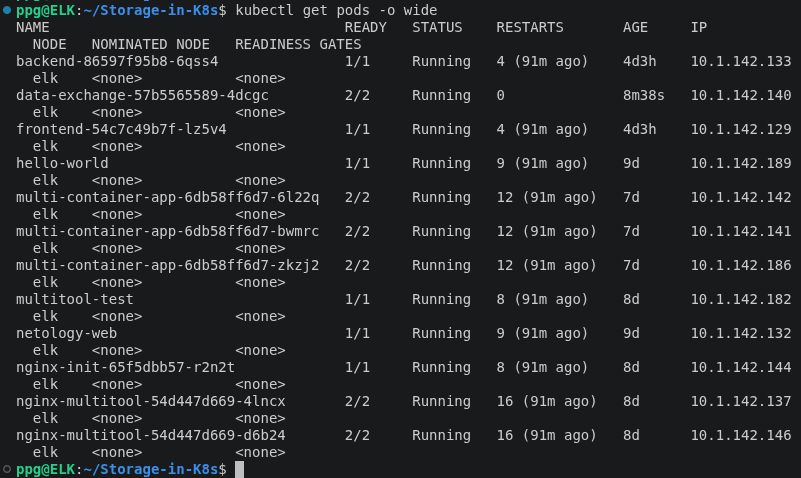

Описание Pod data-exchange: два контейнера подключены к общему тому shared-data типа EmptyDir по пути /shared

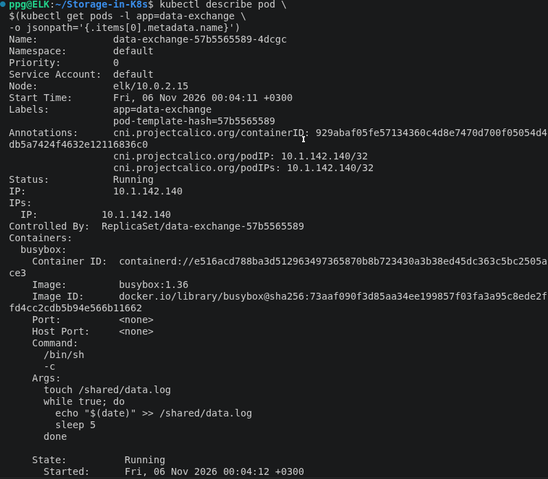

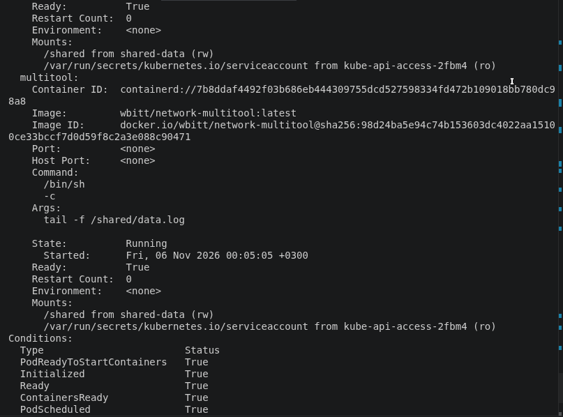

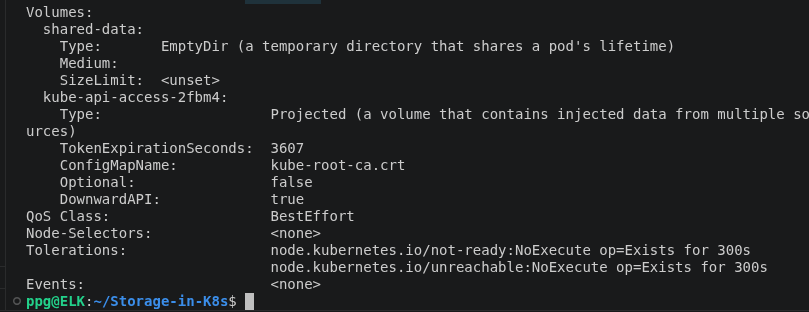

Чтение общего файла data.log контейнером multitool. Новые записи от контейнера busybox появляются с интервалом 5 секунд

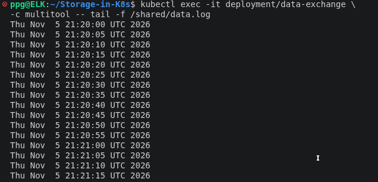

### Задание 2. PV, PVC

### Задача
Создать Deployment приложения, использующего локальный PV, созданный вручную.

### Шаги выполнения
1. Создать Deployment приложения, состоящего из контейнеров busybox и multitool, использующего созданный ранее PVC
2. Создать PV и PVC для подключения папки на локальной ноде, которая будет использована в поде.
3. Продемонстрировать, что контейнер multitool может читать данные из файла в смонтированной директории, в который busybox записывает данные каждые 5 секунд.
4. Удалить Deployment и PVC. Продемонстрировать, что после этого произошло с PV. Пояснить, почему. (Используйте команду kubectl describe pv).
5. Продемонстрировать, что файл сохранился на локальном диске ноды. Удалить PV. Продемонстрировать, что произошло с файлом после удаления PV. Пояснить, почему.
### Что сдать на проверку
- Манифесты:
pv-pvc.yaml
- Скриншоты:
каждый шаг выполнения задания, начиная с шага 2.
- Описания:
объяснение наблюдаемого поведения ресурсов в двух последних шагах.

### Решение 2. 

Манифест pv-pvc.yaml

[pv-pvc.yaml](task2/pv-pvc.yaml)

Создание PersistentVolume и PersistentVolumeClaim. 
Оба ресурса успешно связаны (статус Bound).

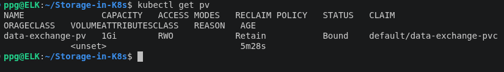

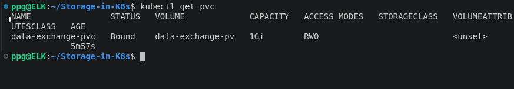

Запуск Deployment data-exchange-pvc и Pod с двумя контейнерами: busybox и multitool. Оба контейнера находятся в состоянии Running

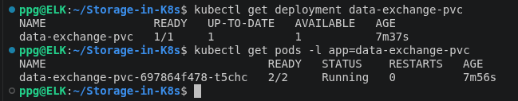

Обмен данными между контейнерами Pod через PersistentVolumeClaim. Контейнер busybox записывает данные в файл data.log каждые 5 секунд, а multitool считывает их из общего тома.

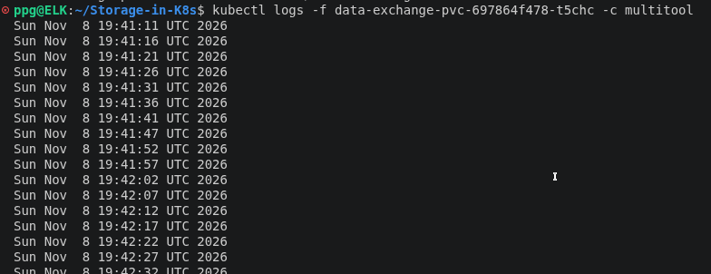

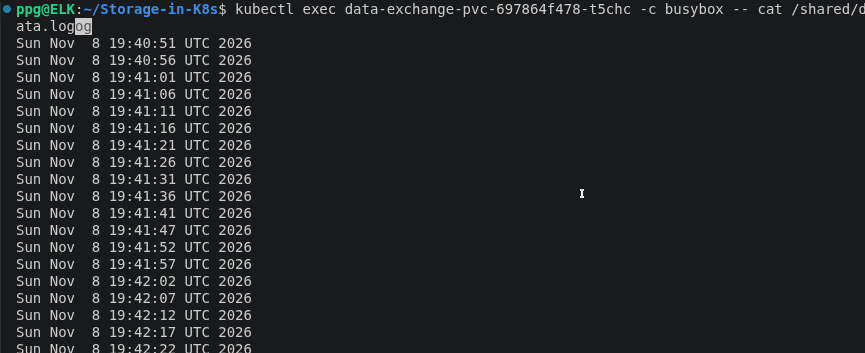

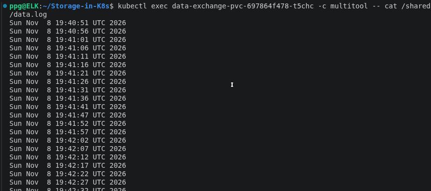

Проверка файла data.log непосредственно в локальном каталоге ноды Kubernetes. Данные физически сохраняются на диске виртуальной машины.

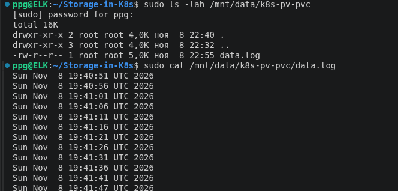

Удаление Deployment и PersistentVolumeClaim. PersistentVolume перешёл в состояние Released. Благодаря политике Retain объект PV и физические данные сохраняются на диске ноды

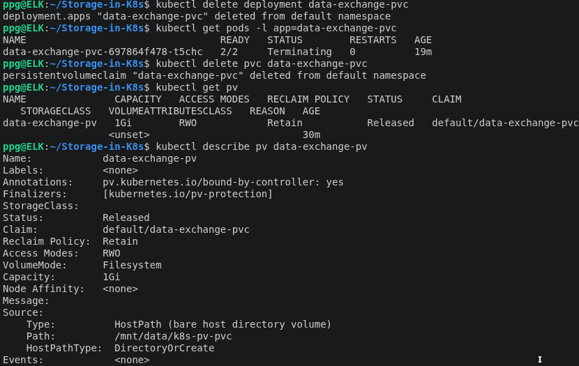

После удаления объекта PersistentVolume файл data.log сохраняется в локальном каталоге hostPath. Удаление объекта Kubernetes не приводит к удалению физических данных на диске ноды

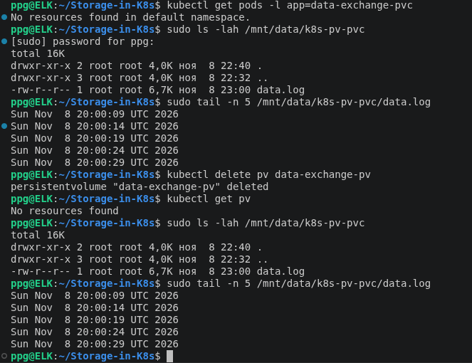

Результат:

- В Kubernetes больше нет объектов PersistentVolume.

- Каталог /mnt/data/k8s-pv-pvc сохранился.

- Файл data.log остался на диске и доступен для чтения.

### Задание 3. StorageClass

### Задача
Создать Deployment приложения, использующего PVC, созданный на основе StorageClass.

### Шаги выполнения
1. Создать Deployment приложения, состоящего из контейнеров busybox и multitool, использующего созданный ранее PVC.
2. Создать SC и PVC для подключения папки на локальной ноде, которая будет использована в поде.
3. Продемонстрировать, что контейнер multitool может читать данные из файла в смонтированной директории, в который busybox записывает данные каждые 5 секунд.
### Что сдать на проверку

- Манифесты:
sc.yaml
- Скриншоты:
каждый шаг выполнения задания, начиная с шага 2

### Решение 3. 

Манифест sc.yaml

[sc.yaml](task3/sc.yaml)

Создание StorageClass local-storage, PersistentVolume и PersistentVolumeClaim. PVC успешно связан с PV (статус Bound)

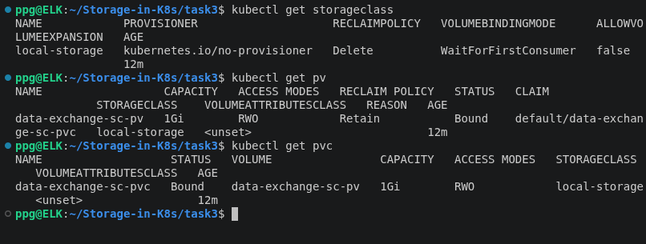

Проверяем состояние Deployment:

`kubectl get deployment data-exchange-sc`

Получаем список Pod:

`kubectl get pods -l app=data-exchange-sc`

Получаем имя созданного Pod:

```
POD=$(kubectl get pod -l app=data-exchange-sc -o jsonpath='{.items[0].metadata.name}')
echo $POD
```

Оба контейнера используют общий том, подключённый через PVC data-exchange-sc-pvc в директорию /shared.

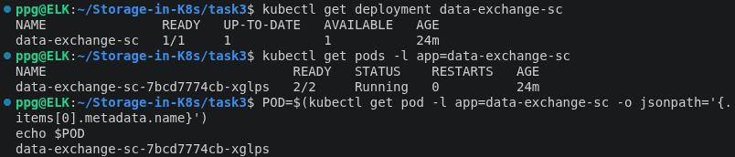

Проверяем чтение файла контейнером Multitool:

`kubectl logs -f "$POD" -c multitool`

В выводе отображаются дата и время, которые BusyBox записывает в общий файл каждые 5 секунд.

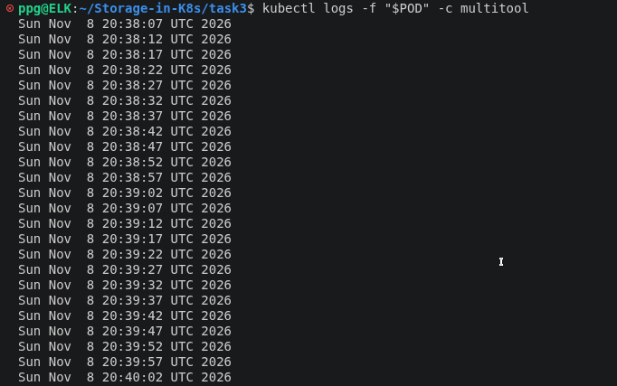

Дополнительно проверяем содержимое файла из обоих контейнеров:


`kubectl exec "$POD" -c busybox -- tail -n 5 /shared/data.log`


`kubectl exec "$POD" -c multitool -- tail -n 5 /shared/data.log`

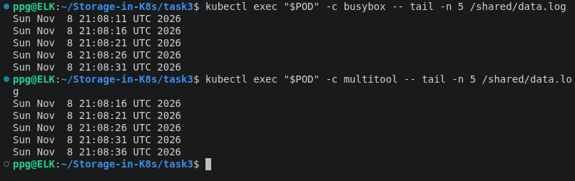

Оба контейнера имеют доступ к одному и тому же файлу, расположенному на общем PersistentVolume.


